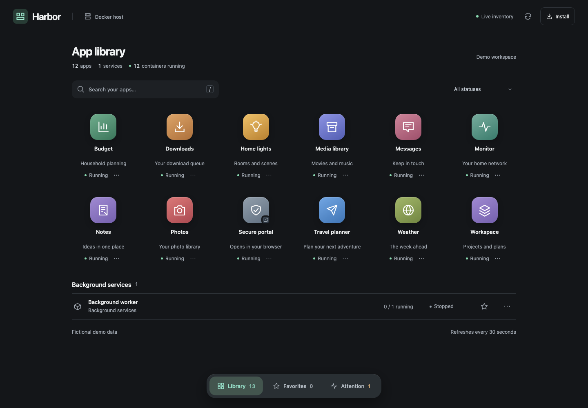

# Harbor

**Your Docker apps, in one installable workspace.**

Harbor discovers the web apps running on your Docker host and brings them together in a native-feeling PWA. Open an app, switch between loaded sessions, or hide the controls and give it the whole screen.



The screenshot uses fictional demo data. Harbor is a self-hosted app launcher, not the CNCF Harbor container registry.

## What it does

- Discovers Compose projects, containers and reachable HTTP interfaces.
- Gives each app a stable HTTPS gateway port, with HTTP streaming and WebSocket support.
- Keeps open apps loaded as you switch between them.
- Uses a compact 48px toolbar; focus mode gives the app the full available viewport.
- Includes search, favorites, health status, container details and on-demand resource samples.
- Installs as a PWA, with an offline shell and clearly marked cached inventory.
- Lets apps with external sign-in open on their normal secure website.

A small Python/aiohttp backend and plain HTML, CSS and JavaScript. No frontend build step, account service or cloud database.

## Before you run it

You need Docker with Compose, a hostname with a trusted TLS certificate, and access to your Docker socket. The optional host maintenance helper needs Python 3.11+ and the Docker CLI; certificate renewal additionally needs OpenSSL and the Tailscale CLI.

**Run Harbor on a private network with trusted users and trusted applications.** It has no built-in user authentication. Restrict access with Tailscale ACLs or an equivalent private network policy. Do not expose its ports directly to the internet. See [the security model](SECURITY.md).

## Quick start with Tailscale

1. Clone and configure:

   ```sh
   git clone https://github.com/newtonlorenz/docker-harbor.git
   cd docker-harbor
   cp .env.example .env
   mkdir -p private data
   ```

2. Edit `.env`. Set `HARBOR_HOST` to your device's full Tailscale hostname and `HARBOR_BIND_IP` to its Tailscale IPv4 address. Leave the project name as `harbor` unless you need a different Compose project name.

3. Enable HTTPS for your tailnet and generate the certificate. Substitute the **same actual hostname** you placed in `.env`:

   ```sh
   tailscale cert --cert-file private/harbor.crt --key-file private/harbor.key YOUR_HOSTNAME.ts.net
   chmod 600 private/harbor.key
   ```

   Follow [Tailscale's HTTPS setup instructions](https://tailscale.com/docs/how-to/set-up-https-certificates) if certificate issuance is not enabled. Alternatively, place a trusted certificate and matching private key at those paths.

4. Start Harbor and attach its gateway to your app networks:

   ```sh
   docker compose up -d --build
   python3 maintain.py
   ```

5. Open `https://YOUR_HOSTNAME.ts.net:8910/`. Initial discovery can take a little time. Install through your browser's install action, or use Safari's Add to Home Screen / Add to Dock.

The shell uses HTTPS port **8910** and app gateways use **9300–9399** on `HARBOR_BIND_IP`. Allow those ports through your private network policy. Port **8909** is a loopback-only diagnostic listener. The default bind address is `127.0.0.1`; change it explicitly for other devices to connect.

## Configuration

| Setting | Purpose |
| --- | --- |
| `HARBOR_HOST` | Hostname covered by your TLS certificate; no scheme or port. |
| `HARBOR_BIND_IP` | Private interface IPv4 address; defaults to loopback. |
| `COMPOSE_PROJECT_NAME` | Compose project name, default `harbor`. |
| `DOCKER_SOCKET` | Host socket path, default `/var/run/docker.sock`. |
| `HARBOR_ATTACH_NETWORKS` | Optional comma-separated network allowlist for `maintain.py`. Empty selects non-internal user-defined bridge networks. |

The Compose file mounts `private/` for certificates, `data/` for persistent gateway-port assignments and `config/` for optional app presentation settings. Back up `data/ports.json` so app origins stay stable. All runtime directories and `.env` are ignored by Git.

### App names, icons and external sign-in

Copy `config/projects.example.json` to `config/projects.json`. Keys are Compose project names (or container names for standalone containers):

```json
{
  "photo-library": {
    "name": "Photos",
    "description": "Your photo library",
    "icon": "camera",
    "palette": "rose"
  },
  "secure-portal": {
    "name": "Secure portal",
    "externalUrl": "https://portal.example.com/"
  }
}
```

Restart Harbor after changing this file. `externalUrl` uses a normal browser launch and replaces embedded launch actions for that project. It must be an HTTPS URL without embedded credentials. This is useful for Cloudflare Access and other sign-in flows that require their own browser context; Harbor does not copy or bypass sessions.

Palettes: `amber`, `indigo`, `rose`, `violet`, `gold`, `mint`, `teal`, `pink`, `blue`, `olive`, `slate`. Icons include `camera`, `chart`, `globe`, `plane`, `wallet`, `light`, `message`, `assistant`, `court`, `shield`, `archive`, `browser`, `teams`, `layers`, `research`, `tool`, `box`, `grid`, `pulse`. Unconfigured apps receive a stable palette and a simple inferred icon.

### Keeping networks and certificates current

Run `python3 maintain.py` after adding app networks or recreating Harbor. The helper adds only Harbor's gateway container to selected networks. To also renew a Tailscale certificate when fewer than seven days remain:

```sh
python3 maintain.py --renew-tailscale-cert
```

You can schedule the helper with your operating system's scheduler after testing it manually. It needs the same Docker and Tailscale permissions as your interactive setup. It restarts Harbor only when renewing its certificate. Other certificate providers need their own renewal process and a Harbor restart after replacement.

## Limits and trust model

This release targets one Docker engine and up to 100 stable app gateway slots. It discovers TCP ports reported by Docker; background jobs and databases remain visible without a web launch action. Keep exposed apps trusted. HTTP discovery sends a GET request to candidate endpoints on startup and every 30 seconds.

The gateway adjusts framing headers and translates origins, redirects and cookies. Apps with hard-coded URLs, OAuth callback allowlists, service workers or restrictive origin checks may still need configuration or a separate browser launch. Cookies are namespaced by port, but cookies themselves are not port-isolated by browsers; this is not a sandbox for mutually untrusted applications. Internal upstream TLS certificates are not verified. Read [SECURITY.md](SECURITY.md) before deployment.

## Development and tests

```sh
python3 -m venv .venv
. .venv/bin/activate
pip install -r requirements.txt
python -m unittest discover -s tests -v
npm ci
npx playwright install chromium
npm test
```

The Python suite tests proxy headers, cookies, redirects, configuration, HTTP and WebSocket forwarding. The browser suite uses fictional fixtures and a temporary local server; it does not contact a real Docker engine or existing user browser sessions. Set `CHROME_PATH` to a compatible Chrome executable to use it instead of the downloaded browser. `npm run screenshots` regenerates the demo images from the same fixtures.

Interface files are mounted directly and update on reload. Backend changes require `docker compose up -d --build`.

See [CONTRIBUTING.md](CONTRIBUTING.md). Licensed under [MIT](LICENSE).
